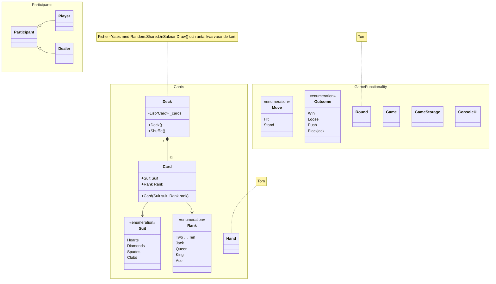
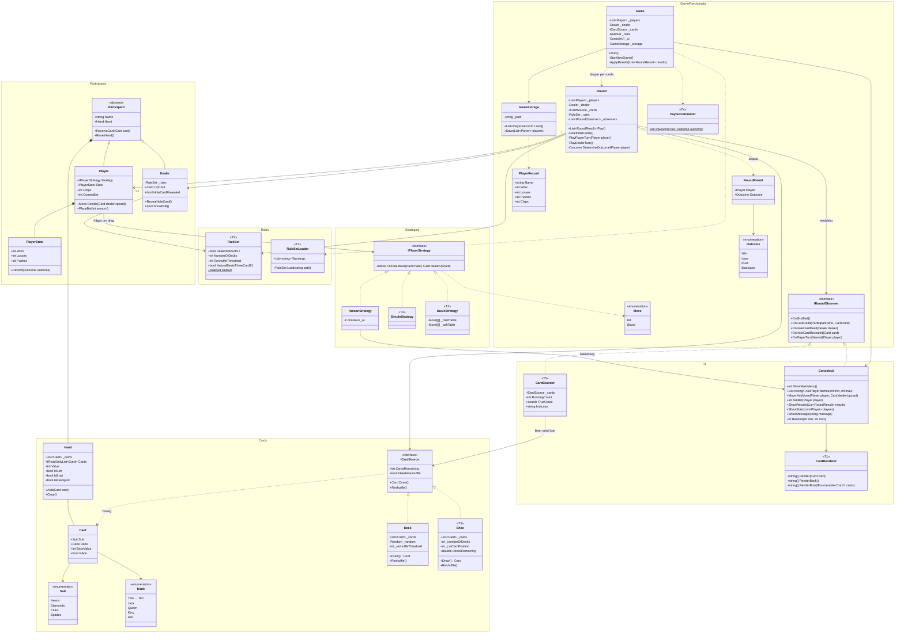

# Arkitektur – Tjugoett

Dokumentet har tre delar:

1. **Nuvarande arkitektur**: hur koden på `dev` ser ut i dag (commit `12418c7`).
2. **Slutarkitektur**: målbilden när grunden och alla fem tillval är klara.
3. **Förklaring av slutarkitekturen**: varför den ser ut så, kopplat till uppgiften och user stories.

---

## 1. Nuvarande arkitektur

Det mesta är tomma skal. Bara `Card`, `Deck` och enumarna har innehåll.



**Läget just nu**

| Klass | Status |
|---|---|
| `Suit`, `Rank`, `Move` | Klara |
| `Outcome` | Finns, men `Loose` ska stavas `Lose` |
| `Card` | Klar (färg och valör) |
| `Deck` | Bygger 52 kort och blandar korrekt. Saknar `Draw()`, `CardsRemaining` och omblandning under 15 kort |
| `Hand`, `Participant`, `Player`, `Dealer` | Tomma. Arv `Player`/`Dealer` → `Participant` finns |
| `Round`, `Game`, `GameStorage`, `ConsoleUI` | Tomma |
| `Program.cs` | Tom, så det finns ingen startpunkt än |

Inga klasser beror ännu på varandra utöver `Card`/`Deck` och arvet.

---

## 2. Slutarkitektur

Klasser markerade med *(T1)–(T5)* hör till respektive tillval. Allt annat är den gemensamma grunden.



---

## 3. Förklaring av slutarkitekturen

### 3.1 Grundidén: tre lager som bara pratar åt ett håll

| Lager | Klasser | Får använda `Console`? |
|---|---|---|
| **Regler** | `Card`, `Hand`, `Deck`/`Shoe`, `Participant`, `Player`, `Dealer`, `Round`, `RuleSet`, strategierna utom `HumanStrategy` | **Nej** |
| **Presentation** | `ConsoleUi`, `CardRenderer`, `HumanStrategy` | Ja (bara `ConsoleUi` skriver och läser) |
| **Styrning och lagring** | `Program`, `Game`, `GameStorage`, `RuleSetLoader` | Nej, går via `ConsoleUi` |

Regellagret vet inte att det finns en konsol (US20). Det är kravet som gör att tillval 1 och 2 kan byggas helt i ny kod: man byter hur något *visas* eller *beslutas* utan att röra `Hand` eller `Round`.

Regellagret kommunicerar utåt på två sätt, och inget av dem kräver `Console`:

- **Beslut in** via `IPlayerStrategy`: `Round` frågar spelarens strategi vilket drag som gäller.
- **Händelser ut** via `IRoundObserver`: `Round` berättar vad som hänt ("kort delat", "hålkort vänt"), och den som vill lyssnar.

### 3.2 Svar på de fyra designfrågorna

**Ska `Card` ha en `Value`?**
Delvis. `Card` har ett `BaseValue` där ess = 1 och klädda kort = 10. Om esset räknas som 11 avgör **`Hand`**, inte kortet, eftersom esset byter värde under handens gång. `Hand.Value` räknas om **varje gång** den läses och sparas aldrig:

```
summa = summan av BaseValue
om handen har ett ess och summa + 10 <= 21  →  summa += 10, IsSoft = true
```

Med flera ess räknas högst ett som 11 (två ess som 11 vore 22), så samma regel fungerar även då (US6). Det här stämmer med README:ns beslut att kort har ett värde, men esslogiken ligger i `Hand`.

**Är givaren en spelare?**
Nej, men båda är **deltagare**. `Participant` (abstrakt) innehåller det gemensamma: namn, hand och att ta emot kort. `Player` har en strategi, statistik och marker. `Dealer` har hålkortet och en fast regel (`ShouldHit()`) och gör aldrig något eget val. Därför ärver `Dealer` inte från `Player`.

**Vem bestämmer vad en spelare gör?**
Spelarens `IPlayerStrategy`. `Player.Decide()` delegerar till `Strategy.ChooseMove(hand, dealerUpcard)`.
- En mänsklig spelare har `HumanStrategy`, som frågar `ConsoleUi.AskMove()`.
- En datorspelare har `SimpleStrategy` eller `BasicStrategy` (T2).

`Round` ser ingen skillnad. Mänskliga spelare och datorspelare med olika strategier kan därför sitta vid samma bord (US15). Det är polymorfism: samma anrop ger olika beteende.

**Var ligger givarens regel?**
På `Dealer.ShouldHit()`, som läser `RuleSet.DealerHitsSoft17`. `Round` frågar bara "ska du köpa?" och känner inte till regeln. Hade regeln legat i `Round` skulle `Round` behöva kunna allas regler och växa med varje tillval.

### 3.3 Klassernas ansvar

| Klass | Ansvar i en mening | User story |
|---|---|---|
| `Card` | Ett kort med färg, valör och basvärde. | US4 |
| `Hand` | Räknar ut värde, mjuk/hård, spräckt och naturlig tjugoett, alltid färskt. | US6, US7, US8 |
| `ICardSource` | Gemensamt kontrakt för det man drar kort ur. | US11 |
| `Deck` | En lek med 52 kort, Fisher–Yates och en delad `Random`. Vill blandas om under 15 kort. | US11 |
| `Participant` | Basklass med namn och hand. | – |
| `Player` | Deltagare som fattar beslut via en strategi och har statistik och marker. | US5 |
| `Dealer` | Deltagare med hålkort och en fast köpregel. | US4, US9 |
| `PlayerStats` | Räknar vinster, förluster och lika. | US10, US12 |
| `Round` | En giv: blanda om vid behov, dela ut, spelarnas turer, givarens tur, avgörande. | US4–US11 |
| `RoundResult` | Utfallet för en spelare i en runda. | US10 |
| `IRoundObserver` | Låter UI och räknare följa rundan utan att påverka den. | US20 |
| `Game` | Meny, spelloop, och sparar efter varje runda. | US1, US2, US12 |
| `GameStorage` | Läser och skriver spelare till fil. Saknad eller trasig fil ger en tom lista i stället för krasch. | US3, US12 |
| `PlayerRecord` | Det som sparas: namn, resultat och marker (en DTO, utan strategi). | US3 |
| `ConsoleUi` | All in- och utmatning. Validerar inmatning och frågar igen vid fel. | US1, US13 |

**Shared Random:** `Random.Shared` (som `Deck` redan använder) är en instans för hela programmet och uppfyller kravet. Skickar man i stället in en `Random` i konstruktorn kan man använda ett fast frö i tester.

### 3.4 Avgörandet (`Round.DetermineOutcome`)

Reglerna kontrolleras i den här ordningen, eftersom ordningen spelar roll:

1. Spelaren har spräckt → `Lose` (även om givaren spräcker)
2. Spelaren har naturlig och givaren har det också → `Push`
3. Spelaren har naturlig → `Blackjack` (slår även 21 av tre kort)
4. Givaren har naturlig → `Lose`
5. Givaren har spräckt → `Win`
6. Annars jämförs värdena → `Win`, `Lose` eller `Push`

`Blackjack` är ett eget utfall så att T4 kan betala 3:2. I statistiken räknas det som en vinst.

Med T3 och `NaturalBeatsThreeCard21 = false` jämförs punkt 3 och 4 i stället som vanliga 21:or.

### 3.5 En runda steg för steg

1. `Game` skapar en ny `Round` med spelarna, givaren, kortkällan, `RuleSet` och observatörerna (`ConsoleUi` och eventuellt `CardCounter`).
2. Om `ICardSource.NeedsReshuffle` är sant blandas en ny lek, och `OnShuffled()` skickas.
3. Två öppna kort delas ut till varje spelare (`OnCardDealt`), ett öppet till givaren och ett hålkort (`OnHoleCardDealt`, utan kortets värde).
4. Varje spelare får sin tur: `Player.Decide()` anropas tills spelaren stannar, spräcker eller har 21.
5. Givaren vänder hålkortet (`OnHoleCardRevealed`) och köper så länge `ShouldHit()` är sant.
6. `Round` returnerar en lista med `RoundResult`. Den skriver inte ut något själv.
7. `Game` uppdaterar `PlayerStats`, betalar ut marker (T4), visar resultatet via `ConsoleUi` och sparar med `GameStorage` (US12).

### 3.6 Hur tillvalen kopplas in

| Tillval | Nya klasser | Ändring i gemensam kod |
|---|---|---|
| **T1 Kortgrafik** | `CardRenderer` returnerar `string[]` per kort. `RenderRow` flätar ihop rad för rad så att korten hamnar bredvid varandra. | Ingen. `ConsoleUi` använder renderaren och sätter `ForegroundColor` (röda hjärter och ruter). |
| **T2 Datorspelare** | `SimpleStrategy` (köper under 17) och `BasicStrategy` (tabell indexerad på handvärde × givarens öppna kort, en tabell för hård och en för mjuk hand). | Ingen, eftersom `IPlayerStrategy` redan finns i grunden. `Game` får ett menyval för att lägga till datorspelare. |
| **T3 Husregler** | `RuleSet` och `RuleSetLoader` läser en textfil (`key=value`). Saknas filen används `RuleSet.Default` och en varning visas. | `Dealer.ShouldHit()` (mjuk 17), `Deck`/`Shoe` (antal lekar och omblandningsgräns), `Round.DetermineOutcome()` (naturlig mot 21). |
| **T4 Marker** | `PayoutCalculator`: vinst 1:1, naturlig 3:2, lika ger insatsen tillbaka. | `Player` får `Chips`, `CurrentBet` och `PlaceBet()` (insats > 0 och ≤ marker). `Game` frågar om insats före given och tar bort spelare utan marker. `PlayerRecord` sparar markerna. |
| **T5 Sko och korträkning** | `Shoe` implementerar `ICardSource` med skiljekort i bakre fjärdedelen. `CardCounter` implementerar `IRoundObserver` och räknar Hi-Lo. | `Deck` ersätts av `ICardSource` i `Round` och `Game`. `CardCounter` får aldrig se hålkortet förrän det vänds, därför skickar `OnHoleCardDealt` inget kort. |

För att grunden ska vara redo för tillvalen behöver tre saker finnas redan i vecka 1, även om de bara har en implementation var:

- `IPlayerStrategy`, med `HumanStrategy` som enda implementation från början
- `IRoundObserver`, med `ConsoleUi` som enda lyssnare från början
- `ICardSource`, med `Deck` som enda implementation från början

Då blir T2 och T5 nya klasser i stället för ombyggnader. T3 och T4 rör gemensam kod, vilket uppgiften säger att de ska, och de ändringarna går som PR:er som granskas av den som skrev originalet.

`IRoundObserver` kan använda C#:s *default interface methods* (tomma standardimplementationer). Då behöver `CardCounter` bara implementera de metoder den bryr sig om.

### 3.7 Från nu till mål: att göra i grunden

- [ ] Byt namn på `Outcome.Loose` till `Lose`
- [ ] `Card.BaseValue` och `IsAce`
- [ ] `Deck`: `Draw()`, `CardsRemaining`, `NeedsReshuffle` (< 15) och `Reshuffle()`. Inför `ICardSource`
- [ ] `Hand` med värde som beräknas vid varje läsning, inklusive flera ess
- [ ] `Participant` (abstrakt), `Player` med `IPlayerStrategy` och `PlayerStats`, och `Dealer` med hålkort och `ShouldHit()`
- [ ] `Round` med `IRoundObserver`, utan `Console`
- [ ] `ConsoleUi` med menyn "Nytt spel / Visa resultat / Avsluta", validering och `HumanStrategy`
- [ ] `GameStorage` som tål saknad eller trasig fil
- [ ] `Game` och `Program.cs` som startpunkt
- [ ] Uppdatera README:ns designbeslut ("Givaren är en AI" → givaren följer en fast regel och gör inga val)
